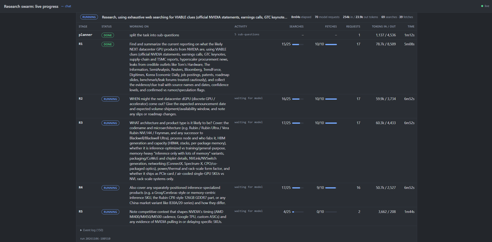

# Local Research Swarm

A self-hosted, multi-agent research system built on
[Pydantic AI](https://ai.pydantic.dev). A planner splits a question into
sub-questions, parallel researchers search the web and read pages and PDFs, and
a writer synthesizes a report with sources. It runs against any
OpenAI-compatible endpoint (vLLM, llama.cpp, SGLang, Ollama, LM Studio, …) plus
three self-hosted services. No cloud API keys are needed.

- **Grounded answers:** a researcher's answer is rejected unless it fetched
  pages and cited only URLs it actually opened.
- **Portable across endpoints:** by default it needs nothing beyond chat
  completions and tool calling.
- **Survives failures:** a failed planner, researcher or writer degrades the
  run instead of aborting it, and every stage of every run is saved to disk.
- **Multiple LLM endpoints:** named profiles for any OpenAI-compatible server
  (vLLM, llama.cpp, LM Studio, Ollama, OpenRouter…) or Anthropic's API. Each
  agent role gets its own, and researchers can share a pool of endpoints, each
  with its own concurrency limit.
- **Observable and controllable:** a live progress page shows what every
  sub-agent is doing, with token, request, search and fetch counts. Its
  buttons finalize, restart or stop individual researchers, wrap up or abort
  a run, and re-run, edit or add sub-questions afterwards. Optional
  OpenTelemetry tracing records every model call and tool call in Arize
  Phoenix.
- **Configured in files:** prompts are Markdown and limits are TOML; the code
  doesn't need editing for tuning.

```
                     ┌──────────────────────────────────────────────────┐
  Browser ─:8000─►   │  Swarm host (any Linux box with Python + Docker) │
                     │                                                  │
                     │  swarm_web.py  (Pydantic AI web chat, uvicorn)   │
                     │    └─ orchestrator ─► run_research tool          │
                     │         └─ planner ─► N researchers ─► writer    │
                     │                         │          │             │
                     │              web_search ┘          └ fetch_page  │
                     │                  │                   │       │   │
                     │            SearXNG :8888    Crawl4AI :11235  │   │
                     │                             (HTML)  docling :5001│
                     │                                     (PDF + OCR)  │
                     └────────────────────────┬─────────────────────────┘
                                              │ OpenAI-compatible API
                                              ▼
                     ┌──────────────────────────────────────────────────┐
                     │  LLM endpoint: vLLM / llama.cpp / SGLang / …     │
                     │  (any OpenAI-compatible server with tool calls)  │
                     └──────────────────────────────────────────────────┘
```

Everything is reached over HTTP and every address is an environment variable,
so the services can share one machine or be spread across several.

---

## Contents

1. [Quick start](#1-quick-start)
2. [Requirements](#2-requirements)
3. [Configuration](#3-configuration)
4. [How it works](#4-how-it-works)
5. [Watching and controlling a run](#5-watching-and-controlling-a-run)
6. [Setting up the services](#6-setting-up-the-services)
7. [Setting up an LLM endpoint](#7-setting-up-an-llm-endpoint)
8. [Troubleshooting](#8-troubleshooting)
9. [Project layout](#9-project-layout)

---

## 1. Quick start

Assumes an LLM endpoint is already running (see
[§7](#7-setting-up-an-llm-endpoint)). The three support services can be started
for you with Docker (see [§6](#6-setting-up-the-services)).

```bash
git clone <this repo> research-swarm && cd research-swarm
python3 -m venv .venv && source .venv/bin/activate
pip install -U pip && pip install -r requirements.txt

./services up                    # SearXNG + Crawl4AI + docling in Docker (skip if you run your own)
./services write-env             # creates/updates sourceMe with their URLs and token
$EDITOR sourceMe                 # set LLM_BASE_URL and LLM_MODEL
source sourceMe
# optional: several endpoints / models per agent (§3.2)
cp endpoints.example.toml endpoints.toml

# optional, recommended: enable more SearXNG engines so rate limits on one don't empty searches (§6.3)
tools/searxng_engines.py --settings .services/searxng/settings.yml \
    --restart research-swarm-searxng-1 recommend --apply

python doctor.py                 # preflight: services reachable, tool calling works
./start_swarm                    # web chat UI on http://<host>:8000
                                 # live progress on http://<host>:8000/progress
```

To run from the command line without the web UI:

```bash
source sourceMe
python swarm_pydantic_ai.py "When does NVIDIA Rubin ship, and what are its specs?"
```

Results print to the terminal and are saved under `reports/<timestamp>/`. The
live progress page is part of the web UI and isn't served for CLI runs; the
terminal shows the same events, and `metrics.json` is saved either way.

---

## 2. Requirements

| Component | Purpose | Requirement |
|---|---|---|
| Python | runs the swarm | 3.12+ (uses `tomllib`) |
| Docker + Compose plugin | `./services` (optional) | only if you want the support services started for you |
| pydantic-ai | agent framework | ≥ 2.60 (`requirements.txt`) |
| LLM endpoint | all agents | OpenAI-compatible `/v1/chat/completions` with **tool calling** |
| [SearXNG](https://github.com/searxng/searxng) | `web_search` | JSON output format enabled |
| [Crawl4AI](https://github.com/unclecode/crawl4ai) | `fetch_page` for HTML | `/md` endpoint |
| [docling-serve](https://github.com/docling-project/docling-serve) | `fetch_page` for PDFs | `/v1/convert/source`; only needed for PDFs |

### LLM endpoint compatibility

By default the swarm needs only two things from the server: chat completions and
tool calling. It sends one system message per request and never sends
`response_format` (see [§3.4](#34-structured-output-modes)).

| Server | Status | Server-side requirement |
|---|---|---|
| vLLM 0.19 (Qwen3.5-122B-A10B) | tested | `--enable-auto-tool-choice --tool-call-parser <parser for your model>` |
| strata (Qwen3.8-Flash-Next) | tested | none; it rejects `response_format` + tools, so stay on `prompted` |
| llama.cpp `llama-server` | expected to work, untested | `--jinja` (tool calling); a context size (`-c`) larger than `max_tokens` plus prompt |
| SGLang, Ollama, LM Studio | expected to work, untested | tool calling enabled for the loaded model |

The model must be good at tool calling. Thinking models are fine, but give
them a large `max_tokens` (see [§8](#8-troubleshooting)).

`python doctor.py` checks this for you. It asks the model for a real tool call
and reports whether `native` structured output would also work on this server.

---

## 3. Configuration

### 3.1 Environment (`sourceMe`)

Copy `sourceMe.example` to `sourceMe` (gitignored), fill it in, and
`source sourceMe` before running anything. Don't execute it.

| Variable | Default | Meaning |
|---|---|---|
| `LLM_BASE_URL` | `http://localhost:8080/v1` | OpenAI-compatible base URL; must end in `/v1`. Used when there's no `endpoints.toml`, or referenced from it as `${LLM_BASE_URL}` |
| `LLM_MODEL` | `qwen3.5-122b` | Model id as `/v1/models` reports it (llama-swap aliases work) |
| `LLM_API_KEY` | `local` | Only if the server checks keys (llama.cpp `--api-key`, LM Studio, proxies) |
| `LLM_OUTPUT_MODE` | *(unset)* | `prompted` / `native` / `tool`; overrides `output_mode` in every profile and toml |
| `SEARXNG_URL` | `http://localhost:8888` | SearXNG base URL |
| `CRAWL4AI_URL` | `http://localhost:11235` | Crawl4AI base URL |
| `CRAWL4AI_API_TOKEN` | *(empty)* | Bearer token set on the Crawl4AI container |
| `DOCLING_URL` | `http://localhost:5001` | docling-serve base URL |
| `OTEL_EXPORTER_OTLP_ENDPOINT` | *(unset)* | Turns on tracing, e.g. `http://localhost:6006` for Phoenix (see [§5.3](#53-tracing-with-arize-phoenix)) |
| `OTEL_EXPORTER_OTLP_HEADERS` | *(unset)* | Auth for the collector, e.g. `authorization=Bearer%20<token>`; `./services write-env` sets it for its Phoenix |
| `PHOENIX_PROJECT_NAME` | `research-swarm` | Phoenix project the traces are filed under |
| `OTEL_EXPORTER_OTLP_TRACES_ENDPOINT`, `OTEL_SERVICE_NAME` | *(unset)*, `research-swarm` | Standard OpenTelemetry overrides: a traces-only endpoint (used as-is, no `/v1/traces` appended), and the service name on spans |
| `SWARM_ENDPOINTS` | `./endpoints.toml` | Path of the endpoint profiles file ([§3.2](#32-llm-endpoints-endpointstoml)) |
| `LLM_DEBUG` | *(unset)* | `1` dumps every LLM request/response to stderr |

### 3.2 LLM endpoints (`endpoints.toml`)

Which model each agent uses, and on which server. Without `endpoints.toml`
there is a single endpoint, `default`, built from `LLM_BASE_URL`, `LLM_MODEL`
and `LLM_API_KEY`, so a plain `sourceMe` setup works as-is. To use several:

```bash
cp endpoints.example.toml endpoints.toml     # gitignored: it may hold URLs and keys
```

```toml
[profiles.local]                  # one profile per endpoint (or per model on one)
provider = "openai"               # any OpenAI-compatible server
base_url = "${LLM_BASE_URL}"      # ${VAR} / ${VAR:-default} read the environment
model = "${LLM_MODEL}"
api_key = "${LLM_API_KEY:-local}"
max_concurrency = 4               # agents it serves at once

[profiles.fast]                   # e.g. a second box on your tailnet
provider = "openai"
base_url = "http://<other-host>:8080/v1"
model = "qwen3.6-35b-a3b"
max_concurrency = 6

[profiles.claude]
provider = "anthropic"
model = "claude-sonnet-5-5"
api_key = "${ANTHROPIC_API_KEY}"
output_mode = "tool"

[agents]
orchestrator = "local"            # web chat (restart to change)
planner = "claude"
researcher = ["local", "fast"]    # a pool
writer = "claude"
```

| Profile key | Default | Meaning |
|---|---|---|
| `provider` | `openai` | `openai` (OpenAI-compatible `/v1/chat/completions`) or `anthropic` |
| `base_url` | | Ends in `/v1` (openai only) |
| `model` | | Model id as the endpoint names it |
| `api_key` | `local` | Literal or `${ENV_VAR}`. Keep real keys in the environment |
| `max_concurrency` | 4 | Agents this endpoint serves at once. Match vLLM `--max-num-seqs` / llama.cpp `--parallel` |
| `output_mode` | *(agent toml)* | `prompted` / `native` / `tool` for this endpoint ([§3.4](#34-structured-output-modes)) |
| `merge_system_messages` | `true` | Send instructions as one system message (Qwen-style templates reject a second) |
| `json_object_output` | `false` | Let `prompted` mode send `response_format: json_object` |

How it's used:

- **Pools and concurrency.** Each stage (planner, every researcher attempt,
  writer) takes a slot on an endpoint from its role's list and holds it until
  it finishes. A researcher gets the least-busy endpoint in its pool that has
  a free slot, or waits for one. The progress page shows each stage's endpoint
  and the live load per endpoint (`local 3/4`). `max_workers` in
  `swarm.toml` still caps researchers overall. Waiting for a slot doesn't
  count against an agent's `timeout_s`.
- **Edits apply to the next run.** `endpoints.toml` is re-read at the start of
  every run and post-run job, with no restart needed, except for the
  `orchestrator` line. It's validated at startup too, so a typo fails loudly.
- **Check it:** `python doctor.py` tests every profile in use: reachable,
  model listed, tool calling, `native` support (an API-key check for
  Anthropic). `./show_config` prints the profiles with keys masked.
- **Anthropic** needs the `anthropic` SDK (`pip install anthropic`;
  included with the full `pydantic-ai` package) and `ANTHROPIC_API_KEY`.
  Hosted models are billed per token, and a large run here can use several
  hundred thousand input tokens, mostly researchers re-reading their growing
  context. Put researchers on a local endpoint and the planner and writer on
  the hosted one.
- **Security.** Anyone who can reach the web UI can start runs that use these
  endpoints, including billed ones. Keep port 8000 on a network you trust.

### 3.3 Agents (`agents/*.toml`, `prompts/*.md`)

Each agent has a toml file for limits and model settings, and a Markdown prompt
named by its `prompt = "…"` key. `./show_config` prints all of it plus the
current environment. Restart after editing. `start_swarm`'s `--reload` only
watches `.py` files.

Keys above the `[model_settings]` header are read by the swarm. Everything under
`[model_settings]` is sent to the model as request parameters (`temperature`,
`max_tokens`, `top_p`, …), so a limit placed under that header goes to the
server instead of being enforced.

**`agents/swarm.toml`**

| Key | Value | Meaning |
|---|---|---|
| `max_workers` | 4 | Concurrent researchers. Keep ≤ the server's parallel slots (vLLM `--max-num-seqs`, llama.cpp `--parallel`) |
| `min_subquestions` / `max_subquestions` | 1 / 5 | Bounds on the planner's plan |
| `output_retries` | 3 | Retries when structured output fails to parse or validate |
| `preflight` | `true` | Check SearXNG and Crawl4AI before a run; abort if either is down or rejects its token |
| `finalize_on_failure` | `true` | A failed researcher first retries just its answer from the pages it already read |
| `researcher_retries` | 1 | Then re-runs only that researcher from scratch, up to this many times |
| `searxng_dead_after` | 3 | Consecutive empty searches with failing upstream engines before the run aborts |
| `searxng_categories` | `"general"` | SearXNG categories each search covers, e.g. `"general,news"` or `"general,news,science"`. Adds the engines enabled in those categories (Reuters, Bing News, arXiv, Google Scholar, PubMed…) |
| `search_cache_hours` | 24 | Reuse results for an identical query (case and spacing ignored) across researchers, runs and restarts. `0` turns the cache off |
| `search_min_interval_s` | 1.5 | Minimum gap between requests to SearXNG, across the whole process |

**`agents/researcher.toml`**

| Key | Value | Meaning |
|---|---|---|
| `output_mode` | `prompted` | See [§3.4](#34-structured-output-modes) |
| `request_limit` | 55 | Model calls per researcher (each tool round costs 1) |
| `timeout_s` | 1800 | Wall-clock cap per researcher attempt (30 min). Time spent waiting for a free endpoint doesn't count |
| `max_searches` | 10 | `web_search` budget (cached and shared searches count too) |
| `max_fetches` / `min_fetches` | 10 / 2 | `fetch_page` attempts allowed / pages that must have been read successfully before an answer is accepted |
| `page_char_limit` | 10000 | Characters kept per HTML page |
| `pdf_page_limit` / `pdf_char_limit` | 100 / 40000 | Pages converted / characters kept per PDF |
| `[model_settings]` | `temperature = 0.3`, `max_tokens = 16384` | Sent to the model |

**`agents/planner.toml`**: `output_mode = "prompted"`, `request_limit = 5`,
`timeout_s = 1800`, `stream = true`. **`agents/writer.toml`**:
`request_limit = 5`, `timeout_s = 1800`, `stream = true`.
**`agents/orchestrator.toml`** (web UI only): prompt and model settings.

`stream = true` streams the model's output so the progress page can show it
growing ("thinking… 4,210 chars, writing… 12,800 chars"). That matters for the
planner and the writer, whose single request can run for many minutes. The
endpoint must support streaming (vLLM, llama.cpp, strata and Anthropic do).
Researchers don't stream, since streamed tool calls are less reliable on some
servers.

### 3.4 Structured output modes

The planner returns a `Plan` and each researcher returns a `Finding`, both
Pydantic models. pydantic-ai can obtain structured output from the model in
three ways. Each has failed on at least one real server, which is why this is a
setting:

| Mode | What is sent | Pros | Where it breaks |
|---|---|---|---|
| `prompted` **(default)** | JSON schema in the system prompt; the reply text is parsed (code fences stripped) and validated | Needs nothing beyond chat + tools; works everywhere | A weak model can emit bad JSON; it is sent back to retry, up to `output_retries` times |
| `native` | `response_format: json_schema` (constrained decoding) | Output is always valid JSON | Needs server support. Some servers (e.g. strata) refuse it combined with tools: `400 structured response_format with tools/MCP is not supported` |
| `tool` | A forced `final_result` tool call | pydantic-ai's default | vLLM + Qwen3.5: the forced `tool_choice` makes xgrammar expect JSON while the model emits XML tool calls, and the call is dropped (`grammar_matcher.cc … trying to accept new token`) |

Set the mode per agent in its toml, per endpoint with `output_mode` in its
profile, or for everything with `LLM_OUTPUT_MODE` (that order, last wins). On a server where `doctor.py` reports that `native` works with tools
(e.g. vLLM), `LLM_OUTPUT_MODE=native` gives the strongest guarantees.

For OpenAI-compatible endpoints, `endpoints.py` also overrides two pydantic-ai
defaults that break local servers. Both are per-profile settings
(`json_object_output`, `merge_system_messages`):

- `supports_json_object_output=False`. Otherwise `prompted` sends
  `response_format: {"type": "json_object"}`, which brings back the
  `response_format` + tools conflict.
- `openai_chat_supports_multiple_system_messages=False`. All instruction
  parts (date context, prompt file, prompted schema) are merged into **one**
  system message, because Qwen's chat template rejects a system message that
  isn't first (`System message must be at the beginning`).

---

## 4. How it works

### 4.1 Pipeline

1. **Orchestrator** (`swarm_web.py`, web UI only): a chat agent with a single
   tool, `run_research`. Small talk is answered directly; research questions go
   to the swarm, and the report is returned verbatim.
2. **Planner** → `Plan{key_terms[3..20], subquestions[min..max]}`. `key_terms`
   must copy every proper noun, product and distinctive phrase from the task
   verbatim, including terms the model doesn't recognize. This stops it from
   swapping in a concept it knows better for the one you asked about.
3. **Researchers**: one per sub-question, up to `max_workers` in parallel. Each
   gets the full task, the key terms and its sub-question, plus two tools:
   - `web_search(query)` → SearXNG, top 8 results with snippets. Searches go
     through a shared layer (`search.py`): identical queries are answered from
     a 24-hour cache or share one in-flight request, and requests to SearXNG
     are spaced out. A five-researcher run used to fire 100+ near-simultaneous
     searches, which is what gets SearXNG's upstream engines to suspend it
   - `fetch_page(url)` → Crawl4AI for HTML, docling-serve for `.pdf` (with OCR)

   It returns `Finding{subquestion, answer, sources}`.
4. **Writer**: writes one Markdown answer from all findings, with inline
   citations and a Sources section.
5. **Save**: `reports/<run id>/` (the run id is a `YYYYMMDD-HHMMSS`
   timestamp) gets `task.md`, `plan.md`, `finding-N.md`, `report.md` (the
   final answer), `full.md` (report plus raw findings) and `metrics.json`
   (see [§5.1](#51-live-progress-page)).

### 4.2 Grounding guards

The model will happily answer from memory and cite URLs it never opened. These
guards stop that:

- **Output validator.** Only pages that actually returned content count as
  read; a fetch that failed (401, 502, empty page) doesn't. A `Finding` is
  sent back if fewer than `min_fetches` pages were read, or if none of its
  sources were read. Sources that weren't read are removed from an otherwise
  valid answer, not grounds for rejecting it, so one bad citation can't sink
  the answer. Every listed source was still read by that researcher.
- **Tool guards.** `fetch_page` refuses search-result URLs and repeat fetches,
  and both tools enforce their budgets. Each refusal is returned to the model
  as an instruction, so it changes course instead of crashing.
- **Date context.** Every agent's system prompt opens with today's date
  (re-evaluated per run, so a long-running server stays current) and states
  that the model's training data is stale, that unfamiliar names aren't
  evidence of non-existence, and that fetched content beats memory. Without
  this, models add stale years to searches and dismiss products released after
  their cutoff.

### 4.3 Failure handling

A failure costs the smallest piece of work that can be redone, never the whole
run.

| Failure | What happens |
|---|---|
| SearXNG or Crawl4AI down or misconfigured, found **before** the run | **Preflight** (a search that must return results, plus one fetch; cached 5 min) aborts in about a second, before any tokens are spent. The message names the service and the fix |
| The same, found **during** the run (Crawl4AI rejects its token, a service stops answering) | The run aborts at the first occurrence and every researcher is cancelled at once. Nothing keeps burning tokens on a dead service |
| SearXNG's upstream engines are rate-limited or suspended (searches come back empty) | After `searxng_dead_after` consecutive empty searches that SearXNG reports as engine failures, the run aborts and names the engines (e.g. `brave: Suspended: too many requests`) |
| Planner fails (timeout, invalid output after retries, server error) | One researcher is run on the whole task |
| A researcher fails (invalid output after retries, request limit, model error, timeout) | **Only that researcher** is retried; the others' results are kept. (0) *Keep its prose*: if its last move was writing an answer, just not as JSON, that text becomes the answer, with the pages it cites that it actually read as sources; no extra model call. (1) *Finalize*: if it read any pages, its own conversation is continued, with those pages still in context, and asked only for the answer (fresh retry budget, ≤4 requests). (2) If that fails, it is re-run from scratch up to `researcher_retries` times, told why the last attempt failed. (3) Only then is its sub-question reported as unanswered, with the reason |
| Writer fails | The raw findings become the report, with a note at the top |
| A single fetch or search fails | The error text goes back to the model, which picks another source |
| The report has gaps | The orchestrator can call `run_research` at most once per user message (enforced in code), so it can't re-run the whole swarm on its own. Re-run or edit just the weak sub-question from `/progress` ([§5.2](#52-controlling-a-run)) |

The run is saved to `reports/` whenever it reaches the end, even if every
agent failed. An aborted run saves the findings that had finished, with a note
saying why it stopped.
The progress page shows retries as `retrying` with an attempt counter (`R2 ×2`)
and the rejection reason in the event log.

---

## 5. Watching and controlling a run

The chat UI shows `run_research` as a single tool call that can spin for an
hour. Two complementary views show what's happening inside it.

### 5.1 Live progress page

Open **`http://<host>:8000/progress`** next to the chat. The orchestrator also
posts the link when it starts a run.



The page updates live (Server-Sent Events) and shows, for each run:

- **Run summary:** status, elapsed time, total model requests, input and
  output tokens, searches and fetches.
- **One row per stage** (planner, `R1`…`Rn`, writer). Each row shows the
  status (`pending` / `running` / `done` / `failed` / `timeout`), the
  sub-question it's working on, and what it's doing right now (`waiting for
  model`, `→ web_search(...)`, `→ fetch_page(https://…)`, `writing answer`).
  It also shows how long the current activity has lasted, which endpoint
  profile serves the stage, searches and fetches against their budgets,
  model requests, tokens in and out, and elapsed time. Researchers waiting
  for a free worker show as `queued`. Streaming stages show their output
  growing (`thinking… 4,210 chars, writing… 12,800 chars`).
- **Endpoint load** in the header: agents in flight per endpoint against its
  `max_concurrency`.
- **Event log:** timestamped searches, fetches, failures, stage transitions,
  and the writer's start and finish.
- **History:** the last 20 runs. After a server restart the last 10 saved
  runs are reloaded from `reports/`.

Tokens and requests update after every model response, not only when an agent
finishes. That shows the problems that are otherwise invisible: a researcher
burning searches without fetching, one stuck waiting on a model with queued
requests, or input tokens growing as the conversation is re-sent each turn.

Also served: `/progress/state` (JSON snapshot, all runs and full logs) and
`/progress/events` (the SSE stream). Live state lives in the web server
process; a restart (including a `--reload`) reloads finished runs from their
saved files, but kills any run in progress. Each
run's final snapshot is kept as `reports/<run id>/metrics.json`: per-stage
timing, requests, tokens, searches, fetches and the full event log. That file
is written for CLI runs too.

### 5.2 Controlling a run

Buttons on `/progress` act on a run while it's going and after it has finished.

**While it runs**

| Control | Where | What it does |
|---|---|---|
| **Finalize** | researcher row | Stop researching and answer now from the pages already read. Its tools refuse further calls, and one page read is enough |
| **Restart** | researcher row | Throw away the current attempt and start that researcher over. Doesn't use up a `researcher_retries` attempt |
| **Stop** | researcher row | Give up on that sub-question; the report says it wasn't answered. On a queued researcher, it's skipped |
| **Stop** | planner / writer row | Planner: one researcher takes the whole task. Writer: the raw findings become the report |
| **Wrap up** | run | Every running researcher finalizes from what it has read, queued ones are skipped, then the writer runs as normal |
| **Abort run** | run | Stop everything now. Finished findings are saved to `reports/<run>/` with a note; there's no synthesized report |

**After it finishes**

| Control | Where | What it does |
|---|---|---|
| **Re-run** | researcher row | Research that sub-question again from scratch, then rewrite the report |
| **Edit…** | researcher row | Change the sub-question, research it, then rewrite the report |
| **Add sub-question…** | run | Research one more sub-question (`R6`, …), then rewrite the report |
| **Rewrite report** | run, or **Re-run** on the writer row | Run the writer again on the current findings |
| **Stop job** | run | Stop a re-run, add or rewrite; the previous report stays as it was |
| **View report** | run | The current `report.md`; `v1`, `v2`… are the earlier versions |

Each re-run, add or rewrite replaces `report.md`, `full.md`, the `finding-N.md`
files and `findings.json` in the run's folder. The previous report is kept as
`report.vN.md`. Post-run jobs share the researcher worker limit (`max_workers`)
with any other run.

Things to know:

- **The chat isn't updated by post-run jobs.** The chat answer is the report
  as it was when the run finished; use **View report** for the current one.
- **Closing the chat tab doesn't stop a run.** It keeps going in the
  background, saves its report, and stays visible on `/progress`. Use
  **Abort run** to stop it.
- **Runs survive a restart, finished ones at least.** The last 10 runs with a
  saved `metrics.json` and `findings.json` are reloaded on startup, with
  their post-run controls working (re-run, edit, add, rewrite). Older ones
  load on demand when a control names them. A run that was *in progress*
  during a restart is lost; its finished findings are not saved until the
  end.
- **Endpoint:** `POST /progress/api/<run id>/<action>` with a JSON body
  (`stage` with `{"key": "R2", "cmd": "finalize" | "restart" | "stop"}`,
  `wrapup`, `abort`, `rerun` with `{"key", "subquestion"?}`, `add` with
  `{"subquestion"}`, `rewrite`). Requests must send `X-Swarm-Control: 1`, which
  a browser won't send cross-site without a CORS preflight this server never
  approves, so other websites can't press the buttons for you. Like the chat
  itself, the controls have no login: anyone who can reach port 8000 can use
  them.

### 5.3 Tracing with Arize Phoenix

[Phoenix](https://github.com/Arize-ai/phoenix) is a self-hosted trace viewer
for LLM apps. With tracing on, every swarm run becomes one trace: a
`research swarm` root span (under the orchestrator's span in the web UI), with
the planner, each researcher and the writer nested inside. Every model request
is recorded with its full prompt, response, token counts and latency, and every
tool call with its arguments and result. Use it to answer "what did researcher
2 actually read", "which call was slow" or "what did the model see when it went
wrong", and to compare runs.

```bash
./services up phoenix            # prints the UI URL and admin login
./services write-env             # adds OTEL_EXPORTER_OTLP_ENDPOINT and _HEADERS to sourceMe
source sourceMe && python doctor.py   # "tracing collector: OK"
./start_swarm
```

Open `http://localhost:6006` and log in as `admin@localhost` with the password
`./services up phoenix` printed (also stored as `PHOENIX_ADMIN_PASSWORD` in
`.services/env`). Traces are under the `research-swarm` project.

Notes:

- **Tracing is off unless the endpoint variable is set,** and it never blocks
  the swarm: an unreachable collector only logs export warnings.
- **Any OTLP/HTTP collector works.** Phoenix gets the most out of it, because
  the [OpenInference](https://github.com/Arize-ai/openinference) span processor
  converts pydantic-ai's spans into Phoenix's LLM views. Jaeger, Grafana Tempo,
  Langfuse or Logfire work by pointing `OTEL_EXPORTER_OTLP_ENDPOINT` (and
  `_HEADERS`, if the collector needs auth) at them.
- **Phoenix as configured by `./services`** runs with authentication on,
  because traces contain every prompt and response. The swarm authenticates
  with the generated `PHOENIX_ADMIN_SECRET`. The bundled agent assistant (which
  includes server-side bash and web access), code sandboxes and telemetry are
  disabled; only the trace viewer is needed.
- **Persistence and resets.** Traces persist in the `research-swarm_phoenix-data`
  Docker volume. The admin password applies only when that volume is first
  created. To reset it, run `./services down`, then
  `docker volume rm research-swarm_phoenix-data`, then `./services up phoenix`.
  This also deletes all stored traces.

---

## 6. Setting up the services

The swarm needs SearXNG (search), Crawl4AI (HTML pages) and docling-serve
(PDFs). They can run anywhere the swarm can reach; only the URLs in `sourceMe`
matter. Already running your own? Skip this section and put their URLs in
`sourceMe`.

### 6.1 With `./services` (Docker Compose)

`./services` wraps [`compose.yaml`](compose.yaml). It needs Docker Engine with
the Compose plugin. Run it with no arguments for a menu, or use subcommands:

| Command | What it does |
|---|---|
| `./services` | Interactive menu: status, start, stop, logs, write `sourceMe` |
| `./services up [searxng crawl4ai docling phoenix \| all]` | Start the three core services, the ones named, or `all` (adds Phoenix); waits until each answers HTTP |
| `./services status` | Container state and an HTTP health check per service |
| `./services logs <service>` | Follow a service's logs |
| `./services env` | Print the `sourceMe` lines for these services (Phoenix's only while it's running) |
| `./services write-env` | Write those lines into `sourceMe` (created from `sourceMe.example` if missing; old copy kept as `sourceMe.bak`). Only services `./services` is running are written, so values for your own instances are never touched |
| `./services down` | Stop and remove this project's containers |

On first run it creates these files (both gitignored):

- `.services/env`: bind address, ports, a generated Crawl4AI token, generated
  Phoenix secrets and admin password, and optional image overrides. Mode 600.
  Edit it, then run `./services up` again.
- `.services/searxng/settings.yml`: SearXNG config with the JSON API enabled,
  the rate limiter off and a random secret key. It is mounted read-only, so it
  stays editable on the host; run `docker compose --env-file .services/env
  restart searxng` after editing.

Notes:

- **Bind address.** Ports bind to `127.0.0.1` by default, so only this machine
  can reach them. Set `BIND_ADDR=0.0.0.0` in `.services/env` if the swarm runs
  on another host. SearXNG and docling have no authentication, so keep them off
  untrusted networks.
- **Port conflicts.** If a port is already taken (for example by a SearXNG you
  started yourself), that service is skipped with a warning; nothing is
  replaced. Use your existing one, or change the port in `.services/env`.
- **Isolation.** Everything runs as the Compose project `research-swarm`, so
  `./services down` only removes its own containers.
- **Image sizes.** The first `up` downloads about 400 MB for SearXNG, about
  6 GB for Crawl4AI and about 15 GB for docling (Phoenix is about 300 MB). To
  skip PDFs, leave docling out: `./services up searxng crawl4ai`.
- **Phoenix** is optional and covered in [§5.3](#53-tracing-with-arize-phoenix).

### 6.2 Manual `docker run`

The equivalent manual setup, if you'd rather manage containers yourself.

**SearXNG**

```bash
mkdir -p ~/searxng
cat > ~/searxng/settings.yml <<EOF
use_default_settings: true
server:
  secret_key: "$(openssl rand -hex 24)"
  limiter: false        # the rate limiter blocks non-browser clients
search:
  formats: [html, json] # the JSON API returns 403 without json
EOF
docker run -d --name searxng --restart unless-stopped -p 8888:8080 \
  -v ~/searxng/settings.yml:/etc/searxng/settings.yml:ro \
  -e SEARXNG_BASE_URL=http://<host>:8888/ \
  searxng/searxng:latest
curl -s 'http://<host>:8888/search?q=test&format=json' | jq '.results[0].url'
```

Mount the file rather than the directory. SearXNG chowns a mounted config
directory to its own uid, and after that you can't edit it on the host without
sudo. Engine health is at `/stats`.

**Crawl4AI (HTML → Markdown)**

```bash
docker run -d --name crawl4ai --restart unless-stopped \
  -p 11235:11235 --shm-size=1g \
  -e CRAWL4AI_API_TOKEN=<pick-a-token> \
  unclecode/crawl4ai:latest
curl -s -X POST http://<host>:11235/md -H "Authorization: Bearer <token>" \
  -H "Content-Type: application/json" -d '{"url":"https://example.com"}' | jq '.markdown | length'
```

`--shm-size=1g` matters: headless Chromium crashes with Docker's 64 MB default.
The swarm reads the `markdown` key of the `/md` response, and `doctor.py` flags
it if your version names it differently. Crawl4AI can't read PDFs (that's what
docling is for). Sites behind bot protection return 502, and the researcher
moves on.

**docling-serve (PDF → Markdown, with OCR)**

```bash
docker run -d --name docling --restart unless-stopped \
  -p 5001:5001 -e DOCLING_SERVE_ENABLE_UI=1 \
  ghcr.io/docling-project/docling-serve:latest
curl -s http://<host>:5001/health
```

The OCR and layout models ship inside the image, so no cache volume is needed.
CUDA-tagged images speed up OCR. A test UI is at `/ui`. "RapidOCR returned empty
result" warnings on born-digital PDFs are harmless.

### 6.3 More search engines for SearXNG

SearXNG's defaults enable only a few web engines (here: Brave, DuckDuckGo and
Google CSE). Heavy automated use gets those rate-limited or suspended
(`too many requests`, `CAPTCHA`, `access denied`), and then every search comes
back empty. Several capable engines ship **disabled** (Bing, Yahoo, Mwmbl,
Yandex, Google, …). Enabling the ones that work from your host spreads the
load, so one suspension no longer empties the results.

**With the script.** [`tools/searxng_engines.py`](tools/searxng_engines.py)
works with any SearXNG, not just this project's. It needs only Python's
standard library to read, plus PyYAML to edit.

Typical fix: see what's failing, probe the disabled engines, enable the ones
that answer, and restart. Pick the block for how your SearXNG was started:

```bash
source sourceMe                      # sets SEARXNG_URL for the script

# SearXNG started by ./services
tools/searxng_engines.py status
tools/searxng_engines.py recommend
tools/searxng_engines.py --settings .services/searxng/settings.yml \
    --restart research-swarm-searxng-1 recommend --apply

# Your own container: here named "searxng", with its config directory
# mounted from ~/searxng (as in older versions of §6.2)
tools/searxng_engines.py status
tools/searxng_engines.py recommend
sudo chown $USER ~/searxng/settings.yml     # SearXNG chowns a mounted config dir to uid 977
tools/searxng_engines.py --settings ~/searxng/settings.yml --restart searxng recommend --apply

tools/searxng_engines.py status      # afterwards: the test query should return results again
```

`recommend` only reports; `--apply` writes `settings.yml` (keeping a backup)
and restarts the container. The full command set:

```bash
export SEARXNG_URL=http://localhost:8888          # or pass --url

tools/searxng_engines.py status                   # enabled engines, their error rates, a live test query
tools/searxng_engines.py probe bing yahoo qwant   # query engines one at a time (enabled or not)
tools/searxng_engines.py recommend                # probe the disabled web engines; list the ones that answer

# enable the ones that answered, then restart SearXNG so it reloads settings.yml:
tools/searxng_engines.py --settings <settings.yml> --restart <container> recommend --apply
tools/searxng_engines.py --settings <settings.yml> --restart <container> enable bing yahoo
tools/searxng_engines.py --settings <settings.yml> --restart <container> disable duckduckgo
tools/searxng_engines.py --settings <settings.yml> suspend-times --too-many-requests 600
```

- **Which file and container.** For the `./services` SearXNG:
  `--settings .services/searxng/settings.yml --restart research-swarm-searxng-1`.
  For your own, use the file mounted at `/etc/searxng/settings.yml` and the
  container's name.
- **File permissions.** If you mounted the whole config directory, SearXNG
  probably chowned the file to uid 977. Run `sudo chown $USER
  <settings.yml>` first; the script tells you if it can't write.
- **Backups.** Every edit keeps a timestamped backup next to the file, or in
  `~/.local/state/searxng_engines/` when the directory isn't writable (a
  config directory mounted into SearXNG stays owned by uid 977 even after you
  `chown` the file). The script prints where. YAML comments survive only in
  the backup.
- **Safety check.** Engine names are checked against the running SearXNG
  first. A name it doesn't know would make SearXNG fail to start.
- **Probe sparingly.** Probes are spaced 2 s apart (`--delay`). Results depend
  on your host's IP, so "works" means "works from here, right now".

**By hand.** With `use_default_settings: true` at the top of `settings.yml`,
list only the engines you want to change; SearXNG merges each entry into its
built-in definition by name:

```yaml
use_default_settings: true
engines:
  - name: bing
    disabled: false
  - name: yahoo
    disabled: false
  - name: duckduckgo     # keeps getting CAPTCHAs from this host
    disabled: true
search:
  suspended_times:       # seconds an engine is benched after an error
    SearxEngineTooManyRequests: 600
```

Then `docker restart <container>`. Names must match the engine names SearXNG
uses: `status` lists them, as does `GET /config` (the `engines[].name`
fields). Engines in other categories (`news`, `science`) only take part in the
swarm's searches if their category is in `searxng_categories`.

---

## 7. Setting up an LLM endpoint

Any server from the [compatibility table](#llm-endpoint-compatibility) works.
Minimal examples:

```bash
# vLLM (pick the tool parser for your model family: hermes, qwen3_xml, llama3_json, …)
vllm serve <model> --enable-auto-tool-choice --tool-call-parser <parser> \
  --max-num-seqs 4 --served-model-name my-model

# llama.cpp
llama-server -m model.gguf --jinja -c 65536 --parallel 4 --host 0.0.0.0 --port 8080
```

Then set `LLM_BASE_URL=http://<host>:<port>/v1` and `LLM_MODEL` to the served
model id, and run `python doctor.py`. For more than one endpoint, add a
profile per server in `endpoints.toml` ([§3.2](#32-llm-endpoints-endpointstoml)).

[llama-swap](https://github.com/mostlygeek/llama-swap) in front of the server
gives you one stable port and on-demand model loading.

Runs are slow by design. On a ~50 tok/s endpoint, a 4-researcher run with a
few fetches each takes 15–40 minutes, because every tool round re-sends the
growing conversation. Parallelism is capped by the server's concurrent slots.

---

## 8. Troubleshooting

Start with `python doctor.py`. Most problems show up as a FAIL line there.

| Symptom | Cause / fix |
|---|---|
| `404 page not found` | `LLM_BASE_URL` must end in `/v1`, with nothing after it |
| `model_name: X` 404 | `LLM_MODEL` must match an id from `/v1/models` |
| `401` / `403` from the LLM | Server checks keys; set `LLM_API_KEY` |
| `structured response_format with tools/MCP is not supported` | Something is in `native` mode on a server that refuses `response_format` + tools. Use `prompted` (the default); check `LLM_OUTPUT_MODE` |
| `System message must be at the beginning` | A second system message is being sent. The model profile merges them; check you haven't added `@agent.instructions` / `system_prompt` on a separately built model |
| `Exceeded maximum output retries` | The log line includes `last rejection: …` with the validator's or parser's actual complaint. Common causes: a thinking model hitting `max_tokens` (`content: null`, `finish_reason: length`), so raise `max_tokens`; prose instead of JSON in `prompted` mode; or too few pages read. A researcher hitting this is retried automatically (§4.3) |
| `grammar_matcher.cc … accept new token` (vLLM log) | `tool` output mode on vLLM + Qwen; use `prompted` or `native` |
| Researcher finishes with no tool calls / prints tool-call text | Server isn't parsing tool calls: vLLM `--enable-auto-tool-choice --tool-call-parser …`, llama.cpp `--jinja` |
| `[planner] FAILED …; falling back` | Planner couldn't produce a valid plan; the run continues with one researcher. Look at the error; often `max_tokens` or a weak model in `prompted` mode |
| Context-length errors from llama.cpp | Raise `-c`, or lower `max_tokens` / `page_char_limit` |
| Researchers are slow or time out together | `max_workers` exceeds the server's parallel slots; requests queue |
| SearXNG 403 on `format=json` | Add `json` to `search.formats` in `settings.yml` |
| `./services up` skips a service: "port … already in use" | Something else holds the port (often your own instance); use it, or change the port in `.services/env` |
| `./services`: "docker is installed but not usable" | Start Docker, or add yourself to the `docker` group and log in again |
| Can't edit SearXNG `settings.yml` (owned by uid 977) | The config directory was mounted; mount just the file read-only (see §6.2) |
| SearXNG returns 0 results / run aborted "upstream engines are failing" | Brave, Google, DuckDuckGo and others rate-limit or suspend SearXNG after heavy use (`Suspended: too many requests`). `python doctor.py` lists the failing engines. Fix: `tools/searxng_engines.py recommend --apply` enables the disabled engines that work from your host ([§6.3](#63-more-search-engines-for-searxng)); the search cache and throttle keep it from recurring |
| `Crawl4AI rejected CRAWL4AI_API_TOKEN (HTTP 401)` / run aborted | The token in `sourceMe` doesn't match the container's (`docker inspect <container>` shows its env). Fix `sourceMe`, then **restart** `./start_swarm`: `--reload` re-imports code but keeps the old environment |
| Crawl4AI 502 "Blocked by anti-bot protection" | Site-side; the researcher picks another source |
| `PDF FETCH FAILED … no md_content` | docling-serve's response shape differs; the error lists the keys it got |
| `/progress` is empty during a CLI run | The tracker lives in the web server process; CLI runs show progress in the terminal and save `metrics.json` |
| A button says "run not found" | That run has no saved `metrics.json` + `findings.json` (it was in progress during a restart, or predates them) |
| `endpoints.toml: …` error at startup or when a run starts | A profile is invalid; the message names it. Common: `base_url` not ending in `/v1`, or `${VAR}` not set in the shell that started the server (`source sourceMe` first) |
| A stage sits at "waiting for a free endpoint" | Every endpoint in its pool is at `max_concurrency`; see the load in the page header. Raise the limit if the server can take it, or add an endpoint to the pool |
| A button does nothing / "missing X-Swarm-Control header" | A proxy is stripping custom headers; let `X-Swarm-Control` through |
| `/progress` stuck on "reconnecting…" | A proxy in front of uvicorn is buffering the event stream; disable buffering for `/progress/events` |
| doctor: `tracing collector … HTTP 401` | The collector requires auth: run `./services write-env` (Phoenix) or set `OTEL_EXPORTER_OTLP_HEADERS` |
| `Failed to export span batch` / connection refused in the log | `OTEL_EXPORTER_OTLP_ENDPOINT` points at a collector that isn't running; start it or unset the variable |
| No traces in Phoenix | Check the `research-swarm` project; confirm `[tracing] exporting traces to …` was printed at startup |

**Inspecting requests:** `LLM_DEBUG=1 python swarm_pydantic_ai.py "…" 2> debug.log`,
then `grep 'LLM request roles' debug.log` shows each request's message roles,
whether tools were sent and the `response_format`, if any. Check the server's
own logs for the other side.

---

## 9. Project layout

```
├── swarm_pydantic_ai.py   # model, agents, tools, validator, run_swarm(); CLI entry point
├── swarm_web.py           # web chat UI (orchestrator agent + Agent.to_web())
├── agent_config.py        # loads agents/*.toml and prompts/*.md
├── doctor.py              # preflight checks for every dependency (every endpoint profile in use)
├── endpoints.py           # endpoint profiles: loading, models, per-endpoint concurrency
├── endpoints.example.toml # profile template → copy to endpoints.toml (gitignored)
├── search.py              # shared SearXNG access: result cache, throttle, in-flight de-duplication
├── progress.py            # live run tracker behind /progress and metrics.json
├── tracing.py             # optional OpenTelemetry setup (Phoenix or any OTLP collector)
├── web/progress.html      # the live progress page
├── agents/                # per-agent limits and model settings; swarm.toml for fan-out
├── prompts/               # per-agent instructions (Markdown)
├── services               # start/stop/check SearXNG, Crawl4AI, docling, Phoenix (menu or subcommands)
├── tools/searxng_engines.py   # inspect, probe and enable SearXNG engines (works with any SearXNG)
├── compose.yaml           # the Docker Compose project ./services drives
├── sourceMe.example       # environment template → copy to sourceMe (gitignored)
├── start_swarm            # uvicorn launcher for the web UI (port 8000)
├── show_config            # print all agent config, prompts and the current env
├── requirements.txt
├── reports/               # one folder per run (gitignored, created automatically)
├── .services/             # ./services state: ports, tokens, secrets, SearXNG settings (gitignored)
└── .cache/                # search result cache (gitignored)
```
